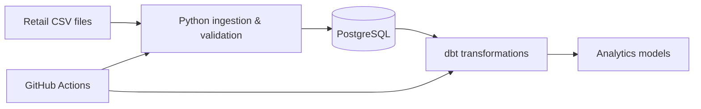
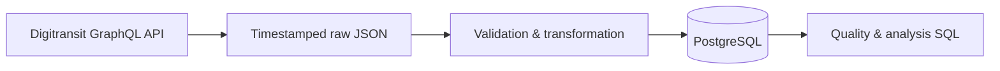

<h1 align="center">Hi, I'm Pradip Neupane 👋</h1>

  <strong>Data Engineering-focused MSc Data Science student at Tampere University</strong>

  Building reliable data pipelines and analytics warehouses with Python, SQL, PostgreSQL, dbt, and Docker, while developing my Databricks and Power BI skills.

  <a href="https://github.com/Neupane-pradip/retail-data-platform">🛒 Retail Data Platform</a> ·
  <a href="https://github.com/Neupane-pradip/tampere-transport-data-platform">🚌 Tampere Transport Platform</a> ·
  <a href="https://github.com/Neupane-pradip/weather-data-pipeline">🌦️ Weather Pipeline</a> ·
  <a href="mailto:neupanepradip32@gmail.com">✉️ Contact</a>

  
  
  
  
  
  
  
  

---

## 👨‍💻 About me

I'm an MSc Data Science student at Tampere University with a background in software development and mathematics.

My main focus is **data engineering**. I learn by building end-to-end projects: collecting data from files and APIs, validating it, loading it into databases, modeling it for analytics, testing the pipeline, and making failures observable.

I'm currently targeting **data engineering internships, trainee positions, and junior data engineer roles**.

## 🚀 Featured data engineering projects

### 🛒 Retail Data Platform

**Python · PostgreSQL · Docker Compose · dbt · GitHub Actions**

A retail data platform that takes raw CSV data through validated ingestion into PostgreSQL and then transforms it into an analytics-ready dbt warehouse.

**What I implemented:**
- Validation and rejection reporting for customers, products, orders, and order items
- Transactional PostgreSQL loads and foreign-key protection
- Version-aware order upserts so older source records cannot overwrite newer data
- Replay-safe loading and duplicate handling
- Reconciliation between stored order totals and order-item totals
- dbt staging models, dimensions, fact tables, and reporting models
- Python tests and dbt data-quality tests
- GitHub Actions CI with PostgreSQL, migrations, pipeline execution, reconciliation, and dbt build/test

➡️ [Explore the Retail Data Platform](https://github.com/Neupane-pradip/retail-data-platform)

---

### 🚌 Tampere Public Transport Data Platform

**Python · GraphQL · PostgreSQL · JSON · Psycopg · unittest**

A real-world API pipeline that collects Tampere public transport departure data from Digitransit, stores raw snapshots, validates and transforms records, and loads observations into PostgreSQL.

**What I implemented:**
- GraphQL API ingestion for real-time and scheduled departure information
- Bounded retries for temporary server, timeout, and connection failures
- Raw timestamped JSON snapshots for traceability
- Validation and transformation before database loading
- Transactional PostgreSQL loads with duplicate protection
- Pipeline-run tracking with stages, outcomes, filenames, and row counts
- Automated unit and pipeline tests, including rollback testing
- SQL-based data quality, analysis, and monitoring
- Scheduled local collection workflow

➡️ [Explore the Tampere Transport Data Platform](https://github.com/Neupane-pradip/tampere-transport-data-platform)

---

### 🌦️ Weather Data Pipeline

**Python · PostgreSQL · Pandas · Streamlit**

A multi-city weather pipeline that collects temperature data for Helsinki, London, and Berlin and turns it into historical records and an interactive dashboard.

**Highlights:**
- Scheduled 15-minute data collection
- API retries and per-city failure handling
- PostgreSQL persistence and duplicate prevention
- Timestamped logging
- Automated retry testing
- Streamlit dashboard for temperature history

➡️ [Explore the Weather Data Pipeline](https://github.com/Neupane-pradip/weather-data-pipeline)

## 🧰 Skills demonstrated in my projects

| Area | Technologies & practices |
|---|---|
| **Programming** | Python, SQL |
| **Data Engineering** | ETL/ELT, API ingestion, validation, dimensional modeling, analytics transformations |
| **Databases** | PostgreSQL, DuckDB |
| **Transformation** | dbt Core, SQL models, staging, dimensions, fact tables |
| **Infrastructure** | Docker, Docker Compose |
| **APIs & Formats** | REST, GraphQL, JSON, CSV |
| **Reliability** | Transactions, retries, logging, duplicate protection, reconciliation, rollback |
| **Data Quality** | Validation rules, rejection reports, dbt tests, SQL quality checks |
| **Testing & CI** | unittest, integration testing, GitHub Actions |
| **Analytics** | Pandas, Streamlit |
| **Development** | Git, GitHub, environment-based configuration |

## 🧱 Databricks and Power BI learning

### Databricks

- Earned the **Databricks Academy Accreditation — Databricks Fundamentals** in October 2026.
- Using **Databricks Free Edition** and working through **Get started with data engineering on Databricks — Academy edition**.
- Learning to navigate Unity Catalog catalogs, schemas, tables, and volumes.
- Working through SQL exercises on listing files in volumes and creating tables from CSV data with `CREATE TABLE AS SELECT`.
- Studying Delta Lake table history and versioning: how versions, timestamps, users, and operations help explain changes to a table.
- Building my understanding of how lakehouse storage and SQL transformations connect to the ingestion and validation patterns in my Python/PostgreSQL projects.

### Power BI

**Current learning focus:** data visualization and business reporting, connecting analytics-ready data to reports that answer clear business questions.

I am developing Power BI skills alongside my SQL and data modelling work. My existing dashboard project uses **Streamlit**; Power BI is a developing skill in my portfolio.

## 🏅 Accreditation

**Databricks Academy Accreditation — Databricks Fundamentals** · October 2026

## 📚 Currently developing

I'm continuing to deepen my data engineering skills through progressively more realistic projects, with focus on:

- Workflow orchestration and scheduling
- Incremental and historical data loading patterns
- Cloud data engineering
- Monitoring and data observability
- Databricks, Delta Lake, Unity Catalog, and PySpark fundamentals
- Power BI reporting and visualization
- Microsoft Azure and Microsoft Fabric

## 🎓 Education

**MSc in Data Science — Tampere University**  
In progress · First semester completed · Expected graduation: December 2027

**BSc in Computing Science and Electrical Engineering**  
Completed · Major: Software Development · Minor: Mathematics

## 📫 Let's connect

I'm interested in data engineering internships, trainee opportunities, junior roles, and collaboration on practical data projects.

**Email:** [neupanepradip32@gmail.com](mailto:neupanepradip32@gmail.com)

---

  <em>Learning data engineering by building systems that collect, validate, transform, test, and explain real data.</em>

